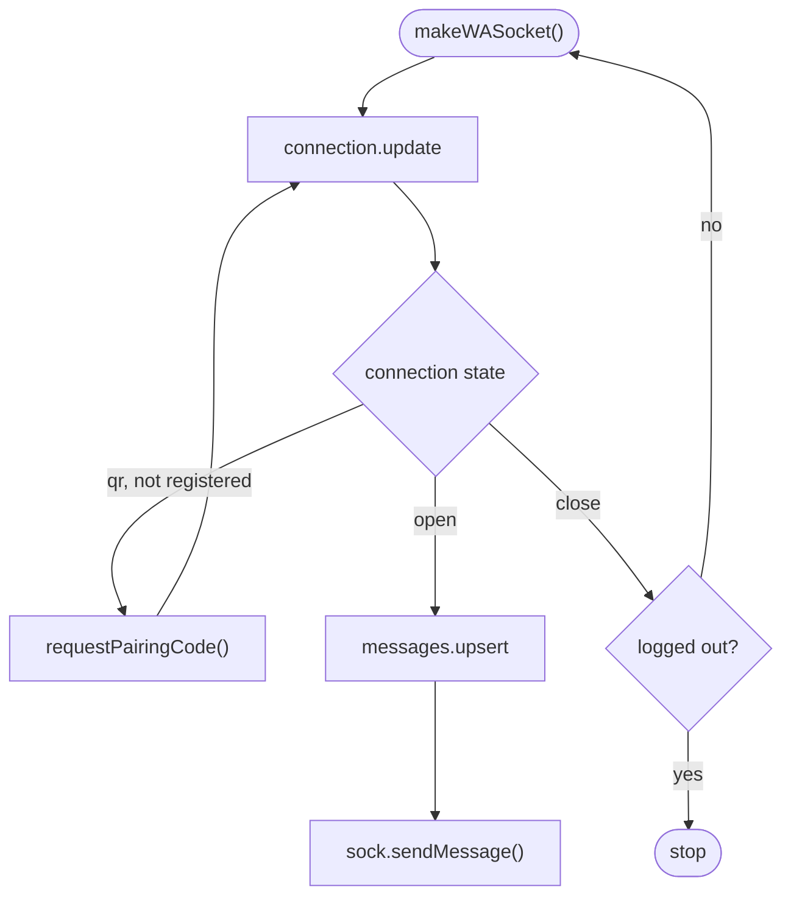

<a id="top"></a>

<div align="center">


# 🌱 @t3/baileys

[](https://www.npmjs.com/package/@t3/baileys)

A lightweight, dependency-minimal Baileys v7 fork with newsletter media upload fixes, interactive messages, albums, and extended message type support.

[](https://www.npmjs.com/package/@t3/baileys)
[](https://www.npmjs.com/package/@t3/baileys)
[](https://www.npmjs.com/package/@t3/baileys)
[](LICENSE)

[](https://nodejs.org)
[](https://bun.sh)
[](#import)

[](https://github.com/t3rri-1/baileys)
[](https://github.com/t3rri-1/baileys/fork)
[](https://github.com/t3rri-1/baileys/issues)

[](#installation) [](#quick-start) [](#sending-messages) [](#sending-media) [](#sending-interactive) [](#sending-payments) [](#additional-contents) [](#events)

☕ For donation: [Saweria](https://saweria.co/itsliaaa)

</div>

```javascript
// Connect once (see Quick start), then send any supported message type
sock.sendMessage(jid, {
   text: '👆🏻 Buttons!',
   footer: '@t3/baileys',
   buttons: [{
      text: '👋🏻 SignUp',
      id: '#SignUp'
   }]
}, {
   quoted: message
})
```

## <a id="table-of-contents"></a>📋 Table of Contents

| Section | Jump to |
|:--|:--|
| [✨ What’s different](#highlights) | [`Highlights`](#highlights) [`Internal adjustments`](#internal-adjustments) [`Message support`](#messages-compat) [`Message flags`](#message-flags) |
| [📥 Getting started](#installation) | [`Installation`](#installation) [`Import`](#import) [`Quick start`](#quick-start) [`Auth state`](#auth-state) [`Data store`](#data-store) [`WhatsApp IDs`](#whatsapp-ids) |
| [✉️ Sending Messages](#sending-messages) | [`Text`](#text) [`Mention`](#mention) [`Reaction`](#reaction) [`Pin Message`](#pin-message) [`Keep Chat`](#keep-chat) [`Forward Message`](#forward-message) [`Contact`](#contact) [`Location`](#location) [`Event`](#event) [`Group Invite`](#group-invite) [`Product`](#product) [`Poll`](#poll) [`Button Response`](#button-response) [`Rich Response`](#rich-response) [`Code Block`](#code-block) [`Inline Entities`](#inline-entities) [`Table`](#table) [`Status Mention`](#status-mention) |
| [📁 Sending Media Messages](#sending-media) | [`Image`](#image) [`Video`](#video) [`Sticker`](#sticker) [`Audio`](#audio) [`Document`](#document) [`Album`](#album) [`Sticker Pack`](#sticker-pack) |
| [👉🏻 Sending Interactive Messages](#sending-interactive) | [`Buttons`](#buttons) [`List`](#list) [`Interactive`](#interactive) [`Hydrated Template`](#hydrated-template) |
| [💳 Sending Payment Messages](#sending-payments) | [`Invite Payment`](#invite-payment) [`Invoice`](#invoice) [`Order`](#order) [`Request Payment`](#request-payment) |
| [👁️ Other Message Options](#message-options) | [`AI Icon`](#ai-icon) [`Ephemeral`](#ephemeral) [`External Ad Reply`](#external-ad-reply) [`Group Status`](#group-status) [`Lottie Sticker`](#lottie-sticker) [`Raw`](#raw) [`Secure Meta Service Label`](#secure-meta-service-label) [`Spoiler`](#spoiler) [`View Once`](#view-once) [`View Once V2`](#view-once-v2) [`View Once V2 Extension`](#view-once-v2-extension) |
| [♻️ Modify Messages](#modify-messages) | [`Delete`](#delete-messages) [`Edit`](#edit-messages) |
| [🧰 Additional Contents](#additional-contents) | [`Find User ID`](#find-user-id) [`Custom Pairing Code`](#custom-pairing-code) [`Image Processing`](#image-processing) [`Newsletters`](#newsletter-management) [`Groups`](#group-management) [`Communities`](#community-management) [`Profile`](#profile-management) [`Business`](#business-management) [`Privacy`](#privacy-management) [`Events`](#events) |
| [🚀 Project](#try-the-bot) | [`Try the Bot`](#try-the-bot) [`Fork Base`](#fork-base) [`Credits`](#credits) |

## <a id="highlights"></a>✨ Highlights

This fork is designed for production use with a focus on clarity and safety:

- 🚫 No obfuscation. Easy to read and audit.
- 🚫 No auto-follow channel (newsletter) behavior.

> [!IMPORTANT]
> To be clear, I am **NOT** the original maintainer of Baileys. Full credit and respect belong to:
>
> https://github.com/WhiskeySockets/Baileys
>
> **Forking is completely acceptable. Removing attribution, contributor credits, or modification history is not.**
>
> Thank you. 🤍

> [!NOTE]
> 📄 This project is maintained with limited scope and is not intended to replace upstream Baileys.
>
> 😞 And, really sorry for my bad english.

<p align="right"><a href="#top">↑ Back to top</a></p>

## <a id="internal-adjustments"></a>🛠️ Internal Adjustments

| Area | Change |
|:--|:--|
| 🖼️ Newsletter media | Fixed an issue where media could not be sent to newsletters due to an upstream issue. |
| 📁 Store | Reintroduced [`makeInMemoryStore`](#data-store) with a minimal ESM adaptation and small adjustments for Baileys v7. |
| 📦 FFmpeg | Switched FFmpeg execution from `exec` to `spawn` for safer process handling. |
| 🗃️ Image backend | Added [`@napi-rs/image`](https://www.npmjs.com/package/@napi-rs/image) as a supported image processing backend in [`getImageProcessingLibrary()`](#image-processing), offering a balance between performance and compatibility. |
| ◻️ QR in terminal | Reintroduced `printQRInTerminal` in `makeWASocket()`. |
| 📡 Signal transport | Migrated signal transport to a Rust-based WASM. |
| 🌱 Dependencies | Reduced transitive dependencies from 13 to just 2 with optional peer integrations. |

<p align="right"><a href="#top">↑ Back to top</a></p>

## <a id="messages-compat"></a>📨 Messages Handling & Compatibility

Expanded messages support for:

| Message | Details |
|:--|:--|
| 🖼️ [Album Message](#album) | Images and videos |
| 👤 [Group Status Message](#group-status) | Group chats only |
| 👉🏻 [Interactive Message](#sending-interactive) | Buttons, lists, native flows, templates, carousels |
| 🎞️ [Status Mention Message](#status-mention) | Takes a list of JIDs |
| 📦 [Sticker Pack Message](#sticker-pack) | A cover plus multiple stickers |
| ✨ [Rich Response Message](#rich-response) | Text, code blocks, and tables in one response |
| 🧾 [Message with Code Blocks](#code-block) | Built-in tokenizer (`tokenizeCode`) |
| 🌏 [Message with Inline Entities](#inline-entities) | Titled links |
| 📋 [Message with Table](#table) | Header, table rows, and footer |
| 💳 [Payment-related Message](#sending-payments) | Payment requests, invites, orders, invoices |

Also:

- 📰 Simplified sending messages with ad thumbnail using [`externalAdReply`](#external-ad-reply), without requiring manual `contextInfo`.
- 💭 Added support for quoting messages inside channel (newsletter).
- 🎀 Added support for [custom button icon](#interactive).

<p align="right"><a href="#top">↑ Back to top</a></p>

## <a id="message-flags"></a>🧩 Additional Message Options

Added optional boolean flags for message handling:

| Flag | What it does | Docs |
|:--|:--|:--|
| `ai` | AI icon on message | [AI Icon](#ai-icon) |
| `mentionAll` | Mention all group participants without requiring their JIDs in `mentions` or `mentionedJid` | [Mention](#mention) |
| `ephemeral` | Message wrapper (`ephemeralMessage`) | [Ephemeral](#ephemeral) |
| `groupStatus` | Message wrapper, group chats only | [Group Status](#group-status) |
| `isLottie` | Message wrapper (`lottieStickerMessage`) | [Lottie Sticker](#lottie-sticker) |
| `spoiler` | Message wrapper (`spoilerMessage`) | [Spoiler](#spoiler) |
| `viewOnce` | Message wrapper (`viewOnceMessage`) | [View Once](#view-once) |
| `viewOnceV2` | Message wrapper (`viewOnceMessageV2`) | [View Once V2](#view-once-v2) |
| `viewOnceV2Extension` | Message wrapper (`viewOnceMessageV2Extension`) | [View Once V2 Extension](#view-once-v2-extension) |
| `interactiveAsTemplate` | Message wrapper that wraps the interactive message into a template | [Interactive](#interactive) |
| `secureMetaServiceLabel` | Secure meta service label on message | [Secure Meta Service Label](#secure-meta-service-label) |
| `raw` | Build your message manually **(DO NOT USE FOR EXPLOITATION)** | [Raw](#raw) |

<p align="right"><a href="#top">↑ Back to top</a></p>

## <a id="installation"></a>📥 Installation

Choose one of the following methods to install `@t3/baileys`.

### 📦 From npm

```bash
# npm
npm i @t3/baileys@latest

# yarn
yarn add @t3/baileys

# pnpm
pnpm add @t3/baileys

# bun
bun add @t3/baileys
```

Or add it to your `package.json`:

```json
{
   "dependencies": {
      "@t3/baileys": "latest"
   }
}
```

### 🐙 From GitHub

```bash
npm i github:t3rri-1/baileys
```

```json
{
   "dependencies": {
      "@t3/baileys": "github:t3rri-1/baileys"
   }
}
```

### 🔗 Requirements and peer dependencies

| Runtime | Requirement |
|:--|:--|
| Node.js | `>=20` |
| Bun | `>=1.2` |
| Modules | ESM. CJS `require()` is tested and working on Node.js 24 ✅ |

All peer dependencies are optional. Install only what you use:

| Package | Version | Needed for |
|:--|:--|:--|
| `qr` | `>=0.5.0` | `printQRInTerminal` |
| `ws` | `^8.13.0` | Node.js versions below 22 |
| `better-sqlite3` | `>=11.0.0` | `useSqliteAuthState` on Node.js versions below 22.13 |
| `sharp` | `>=0.33.3` | Image processing, see [Image Processing](#image-processing) |
| `@napi-rs/image` | `^1.12.0` | Image processing, see [Image Processing](#image-processing) |
| `jimp` | `^1.6.0` | Image processing, see [Image Processing](#image-processing) |

### <a id="import"></a>🧩 Import (ESM & CJS)

```javascript
// --- ESM
import { makeWASocket } from '@t3/baileys'

// --- CJS (tested and working on Node.js 24 ✅)
const { makeWASocket } = require('@t3/baileys')
```

<p align="right"><a href="#top">↑ Back to top</a></p>

## <a id="quick-start"></a>🌐 Connect to WhatsApp (Quick Step)

The example below follows this flow: connect, pair once, then reconnect automatically unless the session was logged out.



```javascript
import { makeWASocket, delay, DisconnectReason, useMultiFileAuthState } from '@t3/baileys'

// --- Connect with pairing code
const myPhoneNumber = '6288888888888'

const connectToWhatsApp = async () => {
   const { state, saveCreds } = await useMultiFileAuthState('session')
    
   const sock = makeWASocket({
      // Optional, "qr" must be installed
      printQRInTerminal: true,

      auth: state
   })

   sock.ev.on('creds.update', saveCreds)

   sock.ev.on('connection.update', async (update) => {
      const { connection, lastDisconnect, qr } = update
      if (qr && !sock.authState.creds.registered) {
         await delay(1500)
         const code = await sock.requestPairingCode(myPhoneNumber)
         console.log('🔗 Pairing code', ':', code)
      }
      else if (connection === 'close') {
         const shouldReconnect = lastDisconnect?.error?.output?.statusCode !== DisconnectReason.loggedOut
         console.log('⚠️ Connection closed because', lastDisconnect.error, ', reconnecting ', shouldReconnect)
         if (shouldReconnect) {
            connectToWhatsApp()
         }
      }
      else if (connection === 'open') {
         console.log('✅ Successfully connected to WhatsApp')
      }
   })

   sock.ev.on('messages.upsert', async ({ messages }) => {
      for (const message of messages) {
         if (!message.message) continue

         console.log('🔔 Got new message', ':', message)
         await sock.sendMessage(message.key.remoteJid, {
            text: '👋🏻 Hello world'
         })
      }
   })
}

connectToWhatsApp()
```

### <a id="auth-state"></a>🔐 Auth State

```javascript
import {
   useMultiFileAuthState,
   useSingleFileAuthState,
   useSqliteAuthState
} from '@t3/baileys'
```

| Function | Storage | Notes |
|:--|:--|:--|
| 🗒️ `useMultiFileAuthState(folder?: string)` | Separate JSON files in a directory | Suitable for users who prefer the traditional multi-file storage approach. |
| 📄 `useSingleFileAuthState(fileName?: string)` | One JSON file | Simpler file management. |
| 🗄️ `useSqliteAuthState(dbPath?: string, ownedDatabase?: object)` | SQLite database | No external SQLite dependency is required when using Bun or Node.js `>=22.13`. For older Node.js versions, install `better-sqlite3`. |

<p align="right"><a href="#top">↑ Back to top</a></p>

## <a id="data-store"></a>🗄️ Implementing Data Store

> [!CAUTION]
> I highly recommend building your own data store, as keeping an entire chat history in memory can lead to excessive RAM usage.

```javascript
import { makeWASocket, makeInMemoryStore, delay, DisconnectReason, useMultiFileAuthState } from '@t3/baileys'

const myPhoneNumber = '6288888888888'

// --- Create your store path
const storePath = './store.json'

const connectToWhatsApp = async () => {
   const { state, saveCreds } = await useMultiFileAuthState('session')
    
   const sock = makeWASocket({
      auth: state
   })

   const store = makeInMemoryStore({
      socket: sock
   })

   store.bind(sock.ev)

   sock.ev.on('creds.update', saveCreds)

   sock.ev.on('connection.update', async (update) => {
      const { connection, lastDisconnect } = update
      if (connection === 'connecting' && !sock.authState.creds.registered) {
         await delay(1500)
         const code = await sock.requestPairingCode(myPhoneNumber)
         console.log('🔗 Pairing code', ':', code)
      }
      else if (connection === 'close') {
         const shouldReconnect = lastDisconnect?.error?.output?.statusCode !== DisconnectReason.loggedOut
         console.log('⚠️ Connection closed because', lastDisconnect.error, ', reconnecting ', shouldReconnect)
         if (shouldReconnect) {
            connectToWhatsApp()
         }
      }
      else if (connection === 'open') {
         console.log('✅ Successfully connected to WhatsApp')
      }
   })

   sock.ev.on('chats.upsert', () => {
      console.log('✉️ Got chats', store.chats.all())
   })

   sock.ev.on('contacts.upsert', () => {
      console.log('👥 Got contacts', Object.values(store.contacts))
   })

   // --- Read store from file
   store.readFromFile(storePath)

   // --- Save store every 3 minutes
   setInterval(() => {
      store.writeToFile(storePath)
   }, 180000)
}

connectToWhatsApp()
```

<p align="right"><a href="#top">↑ Back to top</a></p>

## <a id="whatsapp-ids"></a>🪪 WhatsApp IDs Explain

`id` is the WhatsApp ID, called `jid` and `lid` too, of the person or group you're sending the message to.

| Type | Format |
|:--|:--|
| 👤 People | `[country code][phone number]@s.whatsapp.net`, for example `19999999999@s.whatsapp.net` and `12699999999@lid` |
| 👥 Groups | `123456789-123345@g.us` |
| 🤖 Meta AI | `11111111111@bot` |
| 📣 Channels (newsletters) | `1231111111111@newsletter` |
| 📡 Broadcast lists | `[timestamp of creation]@broadcast` |
| 🎞️ Stories | `status@broadcast` |

<p align="right"><a href="#top">↑ Back to top</a></p>

## <a id="sending-messages"></a>✉️ Sending Messages

> [!NOTE]
> You can get the `jid` from `message.key.remoteJid` in the first example.

### <a id="text"></a>🔠 Text

```javascript
// --- Send a regular text message
sock.sendMessage(jid, {
   text: '👋🏻 Hello'
}, {
   quoted: message
})

// --- Send a text message with a link preview
const urlA = 'https://www.npmjs.com/package/@t3/baileys'

sock.sendMessage(jid, {
   text: urlA + ' 👆🏻 Check it out!',
   linkPreview: {
      'matched-text': urlA,
      title: '🌱 @t3/baileys',
      description: 'Underrated Baileys Fork',
      previewType: 0, // --- Use 1 for video playback in the link preview
      jpegThumbnail: fs.readFileSync('./path/to/image.jpg')
   }
})

// --- Send a text message with a large link preview and favicon
import { prepareWAMessageMedia } from '@t3/baileys'

const urlB = 'https://www.npmjs.com/package/@t3/baileys#readme'

const { imageMessage: image } = await prepareWAMessageMedia({
   image: {
      url: './path/to/image.jpg'
   }
}, {
   upload: sock.waUploadToServer,
   mediaTypeOverride: 'thumbnail-link'
})

// --- Set the thumbnail display size
image.height = 720
image.width = 480

sock.sendMessage(jid, {
   text: urlB + ' 👆🏻 Check it out!',
   linkPreview: {
      'matched-text': urlB,
      title: '🌱 @t3/baileys',
      description: 'Underrated Baileys Fork',
      previewType: 0,
      jpegThumbnail: fs.readFileSync('./path/to/image.jpg'),
      highQualityThumbnail: image,
      linkPreviewMetadata: {
         linkMediaDuration: 0, // --- Duration in seconds (for video/audio content)
         socialMediaPostType: 1, // --- Enum: 0 = NONE, 1 = REEL, 2 = LIVE_VIDEO, 3 = LONG_VIDEO, 4 = SINGLE_IMAGE, 5 = CAROUSEL
      } // --- Additional metadata for large link preview
   },
   favicon: {
      url: './path/to/tiny-image.ico'
   }
})
```

### <a id="mention"></a>🔔 Mention

```javascript
// --- Regular mention
sock.sendMessage(jid, {
   text: '👋🏻 Hello @628123456789',
   mentions: ['628123456789@s.whatsapp.net']
}, {
   quoted: message
})

// --- Mention all
sock.sendMessage(jid, {
   text: '👋🏻 Hello @all',
   mentionAll: true
}, {
   quoted: message
})
```

### <a id="reaction"></a>😁 Reaction

```javascript
sock.sendMessage(jid, {
   react: {
      key: message.key,
      text: '✨'
   }
})
```

### <a id="pin-message"></a>📌 Pin Message

```javascript
sock.sendMessage(jid, {
   pin: message.key,
   time: 86400, // --- Set the value in seconds: 86400 (1d), 604800 (7d), or 2592000 (30d)
   type: 1 // --- Or 2 to remove
})
```

### <a id="keep-chat"></a>🔖 Keep Chat

> [!NOTE]
> Keep Chat can only be used in chats or groups with disappearing messages enabled.

```javascript
sock.sendMessage(jid, {
   keep: message.key,
   type: 1 // --- Or 2 to remove
})
```

### <a id="forward-message"></a>➡️ Forward Message

```javascript
sock.sendMessage(jid, {
   forward: message,
   force: true // --- Optional
})
```

### <a id="contact"></a>👤 Contact

```javascript
const vcard = 'BEGIN:VCARD\n'
            + 'VERSION:3.0\n'
            + 'FN:Lia Wynn\n'
            + 'ORG:Waitress;\n'
            + 'TEL;type=CELL;type=VOICE;waid=628123456789:+62 8123 4567 89\n'
            + 'END:VCARD'

sock.sendMessage(jid, {
   contacts: {
      displayName: 'Lia Wynn',
      contacts: [
         { vcard }
      ]
   }
}, {
   quoted: message
})
```

### <a id="location"></a>📍 Location

```javascript
sock.sendMessage(jid, {
   location: {
      degreesLatitude: 24.121231,
      degreesLongitude: 55.1121221,
      name: '👋🏻 I am here'
   }
}, {
   quoted: message
})
```

### <a id="event"></a>🗓️ Event

```javascript
sock.sendMessage(jid, {
   event: {
      name: '🎶 Meet & Mingle Party',
      description: 'Meet & Mingle Party is a fun, casual gathering to connect, chat, and build new relationships within the community.',
      call: 'audio', // --- Or "video", this field is optional
      startDate: new Date(Date.now() + 3600000),
      endDate: new Date(Date.now() + 28800000),
      isCancelled: false, // --- Optional
      isScheduleCall: false, // --- Optional
      extraGuestsAllowed: false, // --- Optional
      location: {
         name: 'Jakarta',
         degreesLatitude: -6.2,
         degreesLongitude: 106.8
      }
   }
}, {
   quoted: message
})
```

### <a id="group-invite"></a>👥 Group Invite

```javascript
const inviteCode = groupUrl
   .split('chat.whatsapp.com/')[1]
   ?.split('?')[0]

const groupJid = '1201111111111@g.us'
const groupName = '@t3/baileys'

sock.sendMessage(jid, {
   groupInvite: {
      inviteCode,
      inviteExpiration: Date.now() + 86400000,
      text: '👋🏻 Hello, we invite you to join our group.',
      jid: groupJid,
      subject: groupName,
   }
}, {
   quoted: message
})
```

### <a id="product"></a>🛍️ Product

```javascript
import { randomUUID } from 'crypto'

sock.sendMessage(jid, {
   image: {
      url: './path/to/image.jpg'
   },
   body: '👋🏻 Check my product here!',
   footer: '@t3/baileys',
   product: {
      currencyCode: 'IDR',
      description: '🛍️ Interesting product!',
      priceAmount1000: 70_000_000,
      productId: randomUUID(),
      productImageCount: 1,
      salePriceAmount1000: 65_000_000,
      signedUrl: 'https://www.npmjs.com/package/@t3/baileys',
      title: '📦 Starseed (Premium)',
      url: 'https://www.npmjs.com/package/@t3/baileys'
   },
   businessOwnerJid: '0@s.whatsapp.net'
})
```

### <a id="poll"></a>📊 Poll

```javascript
// --- Regular poll message
sock.sendMessage(jid, {
   poll: {
      name: '🔥 Voting time',
      values: ['Yes', 'No'],
      selectableCount: 1,
      toAnnouncementGroup: false,
      endDate: new Date(Date.now() + 28800000), // --- Optional
      hideVoter: false, // --- Optional
      canAddOption: false // --- Optional
   }
}, {
   quoted: message
})

// --- Quiz (only for newsletter)
sock.sendMessage('1211111111111@newsletter', {
   poll: {
      name: '🔥 Quiz',
      values: ['Yes', 'No'],
      correctAnswer: 'Yes',
      pollType: 1
   }
}, {
   quoted: message
})

// --- Poll result
sock.sendMessage(jid, {
   pollResult: {
      name: '📝 Poll Result',
      votes: [{
         name: 'Nice',
         voteCount: 10
      }, {
         name: 'Nah',
         voteCount: 2
      }],
      pollType: 0 // Or 1 for quiz
   }
}, {
   quoted: message
})

// --- Poll update
sock.sendMessage(jid, {
   pollUpdate: {
      metadata: {},
      key: message.key,
      vote: {
         enclv: /* <Buffer> */,
         encPayload: /* <Buffer> */
      }
   }
}, {
   quoted: message
})
```

### <a id="button-response"></a>💭 Button Response

```javascript
// --- Using buttonsResponseMessage
sock.sendMessage(jid, {
   type: 'plain',
   buttonReply: {
      id: '#Menu',
      displayText: '✨ Interesting Menu'
   }
}, {
   quoted: message
})

// --- Using interactiveResponseMessage
sock.sendMessage(jid, {
   flowReply: {
      format: 0,
      text: '💭 Response',
      name: 'menu_options',
      paramsJson: JSON.stringify({
         id: '#Menu',
         description: '✨ Interesting Menu'
      })
   }
}, {
   quoted: message
})

// --- Using listResponseMessage
sock.sendMessage(jid, {
   listReply: {
      title: '📄 See More',
      description: '✨ Interesting Menu',
      id: '#Menu'
   }
}, {
   quoted: message
})

// --- Using templateButtonReplyMessage
sock.sendMessage(jid, {
   type: 'template',
   buttonReply: {
      id: '#Menu',
      displayText: '✨ Interesting Menu',
      index: 1
   }
}, {
   quoted: message
})
```

### <a id="rich-response"></a>✨ Rich Response

> [!NOTE]
> `richResponse[]` is a representation of [`submessages[]`](https://baileys.wiki/docs/api/namespaces/proto/interfaces/IAIRichResponseSubMessage) inside `richResponseMessage`.

> [!TIP]
> You can still use the original [`submessages[]`](https://baileys.wiki/docs/api/namespaces/proto/interfaces/IAIRichResponseSubMessage) field directly.
> The code example below is just an implementation using a helper, not a required structure.

```javascript
sock.sendMessage(jid, {
   disclaimerText: 'RAW submessages structure example',
   richResponse: [{
      text: 'Example Usage',
   }, {
      language: 'javascript',
      code: [{
         highlightType: 0,
         codeContent: 'console.log("Hello, World!")'
      }]
   }, {
      text: 'Pretty simple, right?\n'
   }, {
      text: 'Comparison between Node.js, Bun, and Deno',
   }, {
      title: 'Runtime Comparison',
      table: [{
         isHeading: true,
         items: ['', 'Node.js', 'Bun', 'Deno']
      }, {
         isHeading: false,
         items: ['Engine', 'V8 (C++)', 'JavaScriptCore (C++)', 'V8 (C++)']
      }, {
         isHeading: false,
         items: ['Performance', '4/5', '5/5', '4/5']
      }]
   }, {
      text: 'Does this help clarify the differences?'
   }]
})
```

> [!TIP]
> You can easily add syntax highlighting by importing `tokenizeCode` directly from Baileys.

```javascript
import { tokenizeCode } from '@t3/baileys'

const language = 'javascript'
const code = 'console.log("Hello, World!")'

sock.sendMessage(jid, {
   disclaimerText: 'Example of tokenizing Code Block',
   richResponse: [{
      text: 'Example Usage',
   }, {
      language,
      code: tokenizeCode(code, language)
   }, {
      text: 'Pretty simple, right?'
   }]
})
```

> 💡 Supported Languages: `css`, `html`, `javascript`, `typescript`, `python`, `golang`, `rust`, `c`, `c#`, `c++`, `bash`, `bat`, `powershell`.

### <a id="code-block"></a>🧾 Message with Code Block

> [!NOTE]
> This feature already includes a built-in tokenizer with `tokenizeCode`.

```javascript
sock.sendMessage(jid, {
   disclaimerText: 'Code Block',
   headerText: '## Example Usage',
   contentText: '---',
   code: 'console.log("Hello, World!")',
   language: 'javascript',
   footerText: 'Pretty simple, right?'
})
```

### <a id="inline-entities"></a>🌏 Message with Inline Entities

```javascript
sock.sendMessage(jid, {
   disclaimerText: 'Inline Entities',
   headerText: '## Check Out!',
   contentText: '---',
   links: [{
      text: '1. Google',
      title: 'Popular Search Engine',
      url: 'https://www.google.com/'
   }, {
      text: '2. YouTube',
      title: 'Popular Streaming Platform',
      url: 'https://www.youtube.com/'
   }, {
      text: '3. Modded Baileys',
      title: 'Underrated Baileys Fork',
      url: 'https://www.npmjs.com/package/@t3/baileys'
   }],
   footerText: '---'
})
```

### <a id="table"></a>📋 Message with Table

```javascript
sock.sendMessage(jid, {
   disclaimerText: 'Table',
   headerText: '## Comparison between Node.js, Bun, and Deno',
   contentText: '---',
   title: 'Runtime Comparison',
   table: [
      ['', 'Node.js', 'Bun', 'Deno'],
      ['Engine', 'V8 (C++)', 'JavaScriptCore (C++)', 'V8 (C++)'],
      ['Performance', '4/5', '5/5', '4/5']
   ],
   noHeading: false, // --- Optional
   footerText: 'Does this help clarify the differences?'
})
```

### <a id="status-mention"></a>🎞️ Status Mention

```javascript
sock.sendMessage([jidA, jidB, jidC], {
   text: 'Hello! 👋🏻'
})
```

<p align="right"><a href="#top">↑ Back to top</a></p>

## <a id="sending-media"></a>📁 Sending Media Messages

> [!NOTE]
> For media messages, you can pass a `Buffer` directly, or an object with either `{ stream: Readable }` or `{ url: string }` (local file path or HTTP/HTTPS URL).

### <a id="image"></a>🖼️ Image

```javascript
sock.sendMessage(jid, {
   image: {
      url: './path/to/image.jpg'
   },
   caption: '🔥 Superb'
}, {
   quoted: message
})
```

### <a id="video"></a>🎥 Video

```javascript
sock.sendMessage(jid, {
   video: {
      url: './path/to/video.mp4'
   },
   gifPlayback: false, // --- Set true if you want to send video as GIF
   ptv: false,  // --- Set true if you want to send video as PTV
   caption: '🔥 Superb'
}, {
   quoted: message
})
```

### <a id="sticker"></a>📃 Sticker

```javascript
sock.sendMessage(jid, {
   sticker: {
      url: './path/to/sticker.webp'
   }
}, {
   quoted: message
})
```

### <a id="audio"></a>💽 Audio

```javascript
sock.sendMessage(jid, {
   audio: {
      url: './path/to/audio.mp3'
   },
   ptt: false // --- Set true if you want to send audio as Voice Note
}, {
   quoted: message
})
```

### <a id="document"></a>🗂️ Document

```javascript
sock.sendMessage(jid, {
   document: {
      url: './path/to/document.pdf'
   },
   mimetype: 'application/pdf',
   caption: '✨ My work!'
}, {
   quoted: message
})
```

### <a id="album"></a>🖼️ Album (Image & Video)

```javascript
sock.sendMessage(jid, {
   album: [{
      image: {
         url: './path/to/image.jpg'
      },
      caption: '1st image'
   }, {
      video: {
         url: './path/to/video.mp4'
      },
      caption: '1st video'
   }, {
      image: {
         url: './path/to/image.jpg'
      },
      caption: '2nd image'
   }, {
      video: {
         url: './path/to/video.mp4'
      },
      caption: '2nd video'
   }]
}, {
   quoted: message
})
```

### <a id="sticker-pack"></a>📦 Sticker Pack

> [!IMPORTANT]
> If `sharp` or `@napi-rs/image` is not installed, the `cover` and `stickers` must already be in WebP format.

```javascript
sock.sendMessage(jid, {
   cover: {
      url: './path/to/image.webp'
   },
   stickers: [{
      data: {
         url: './path/to/image.webp'
      }
   }, {
      data: {
         url: './path/to/image.webp'
      }
   }, {
      data: {
         url: './path/to/image.webp'
      }
   }],
   name: '📦 My Sticker Pack',
   publisher: '🌟 Lia Wynn',
   description: '@t3/baileys'
}, {
   quoted: message
})
```

<p align="right"><a href="#top">↑ Back to top</a></p>

## <a id="sending-interactive"></a>👉🏻 Sending Interactive Messages

Buttons, lists, native flows, templates, and carousels.

### <a id="buttons"></a>🔘 Buttons

```javascript
// --- Regular buttons message
sock.sendMessage(jid, {
   text: '👆🏻 Buttons!',
   footer: '@t3/baileys',
   buttons: [{
      text: '👋🏻 SignUp',
      id: '#SignUp'
   }]
}, {
   quoted: message
})

// --- Buttons with Media & Native Flow
sock.sendMessage(jid, {
   image: {
      url: './path/to/image.jpg'
   },
   caption: '👆🏻 Buttons and Native Flow!',
   footer: '@t3/baileys',
   buttons: [{
      text: '👋🏻 Rating',
      id: '#Rating'
   }, {
      text: '📋 Select',
      sections: [{
         title: '✨ Section 1',
         rows: [{
            header: '',
            title: '💭 Secret Ingredient',
            description: '',
            id: '#SecretIngredient'
         }]
      }, {
         title: '✨ Section 2',
         highlight_label: '🔥 Popular',
         rows: [{
            header: '',
            title: '🏷️ Coupon',
            description: '',
            id: '#CouponCode'
         }]
      }]
   }]
}, {
   quoted: message
})
```

### <a id="list"></a>📋 List

> [!NOTE]
> It only works in private chat (`@s.whatsapp.net`).

```javascript
sock.sendMessage(jid, {
   text: '📋 List!',
   footer: '@t3/baileys',
   buttonText: '📋 Select',
   title: '👋🏻 Hello',
   sections: [{
      title: '🚀 Menu 1',
      rows: [{
         title: '✨ AI',
         description: '',
         rowId: '#AI'
      }]
   }, {
      title: '🌱 Menu 2',
      rows: [{
         title: '🔍 Search',
         description: '',
         rowId: '#Search'
      }]
   }]
}, {
   quoted: message
})
```

### <a id="interactive"></a>🗄️ Interactive

```javascript
// --- Native Flow
sock.sendMessage(jid, {
   image: {
      url: './path/to/image.jpg'
   },
   caption: '🗄️️ Interactive!',
   footer: '@t3/baileys',
   optionText: '👉🏻 Select Options', // --- Optional, wrap all native flow into a single list
   optionTitle: '📄 Select Options', // --- Optional
   offerText: '🏷️ Newest Coupon!', // --- Optional, add an offer into message
   offerCode: '@t3/baileys', // --- Optional
   offerUrl: 'https://www.npmjs.com/package/@t3/baileys', // --- Optional
   offerExpiration: Date.now() + 3_600_000, // --- Optional
   nativeFlow: [{
      text: '👋🏻 Greeting',
      id: '#Greeting',
      icon: 'review' // --- Optional
   }, {
      text: '📞 Call',
      call: '628123456789'
   }, {
      text: '📋 Copy',
      copy: '@t3/baileys'
   }, {
      text: '🌐 Source',
      url: 'https://www.npmjs.com/package/@t3/baileys',
      useWebview: true // --- Optional
   }, {
      text: '📋 Select',
      sections: [{
         title: '✨ Section 1',
         rows: [{
            header: '',
            title: '🏷️ Coupon',
            description: '',
            id: '#CouponCode'
         }]
      }, {
         title: '✨ Section 2',
         highlight_label: '🔥 Popular',
         rows: [{
            header: '',
            title: '💭 Secret Ingredient',
            description: '',
            id: '#SecretIngredient'
         }]
      }],
      icon: 'default' // --- Optional
   }],
   interactiveAsTemplate: false, // --- Optional, wrap the interactive message into a template
}, {
   quoted: message
})

// --- Carousel & Native Flow
sock.sendMessage(jid, {
   text: '🗂️ Interactive with Carousel!',
   footer: '@t3/baileys',
   cards: [{
      image: {
         url: './path/to/image.jpg'
      },
      caption: '🖼️ Image 1',
      footer: '🏷️️ Pinterest',
      nativeFlow: [{
         text: '🌐 Source',
         url: 'https://www.npmjs.com/package/@t3/baileys',
         useWebview: true
      }]
   }, {
      image: {
         url: './path/to/image.jpg'
      },
      caption: '🖼️ Image 2',
      footer: '🏷️ Pinterest',
      offerText: '🏷️ New Coupon!',
      offerCode: '@t3/baileys',
      offerUrl: 'https://www.npmjs.com/package/@t3/baileys',
      offerExpiration: Date.now() + 3_600_000,
      nativeFlow: [{
         text: '🌐 Source',
         url: 'https://www.npmjs.com/package/@t3/baileys'
      }]
   }, {
      image: {
         url: './path/to/image.jpg'
      },
      caption: '🖼️ Image 3',
      footer: '🏷️ Pinterest',
      optionText: '👉🏻 Select Options',
      optionTitle: '👉🏻 Select Options',
      offerText: '🏷️ New Coupon!',
      offerCode: '@t3/baileys',
      offerUrl: 'https://www.npmjs.com/package/@t3/baileys',
      offerExpiration: Date.now() + 3_600_000,
      nativeFlow: [{
         text: '🛒 Product',
         id: '#Product',
         icon: 'default'
      }, {
         text: '🌐 Source',
         url: 'https://www.npmjs.com/package/@t3/baileys'
      }]
   }]
}, {
   quoted: message
})

// --- Native Flow with Audio in the Footer
sock.sendMessage(jid, {
   text: '🔈 Music in the footer!',
   audioFooter: {
      url: './path/to/audio.mp3'
   }, // --- Like other media upload methods, buffers and streams are supported
   nativeFlow: [{
      text: '👍🏻 Good, next',
      id: '#Next',
      icon: 'review'
   }, {
      text: '👎🏻 Skip',
      id: '#Skip',
      icon: 'default'
   }]
}, {
   quoted: message
})
```

### <a id="hydrated-template"></a>🫙 Hydrated Template

```javascript
sock.sendMessage(jid, {
   title: '👋🏻 Hello',
   image: {
      url: './path/to/image.jpg'
   },
   caption: '🫙 Template!',
   footer: '@t3/baileys',
   templateButtons: [{
      text: '👉🏻 Tap Here',
      id: '#Order'
   }, {
      text: '🌐 Source',
      url: 'https://www.npmjs.com/package/@t3/baileys'
   }, {
      text: '📞 Call',
      call: '628123456789'
   }]
}, {
   quoted: message
})
```

<p align="right"><a href="#top">↑ Back to top</a></p>

## <a id="sending-payments"></a>💳 Sending Payment Messages

Payment requests, invites, orders, and invoices.

### <a id="invite-payment"></a>➕ Invite Payment

```javascript
sock.sendMessage(jid, {
   paymentInviteServiceType: 3 // 1, 2, or 3
})
```

### <a id="invoice"></a>🧾 Invoice

> [!NOTE]
> Invoice message are not supported yet.

```javascript
sock.sendMessage(jid, {
   image: {
      url: './path/to/image.jpg'
   },
   invoiceNote: '🏷️ Invoice'
})
```

### <a id="order"></a>🛍️ Order

```javascript
sock.sendMessage(jid, {
   orderText: '🛍️ Order',
   thumbnail: fs.readFileSync('./path/to/image.jpg') // --- Must in buffer format
}, {
   quoted: message
})
```

### <a id="request-payment"></a>💳 Request Payment

```javascript
sock.sendMessage(jid, {
   text: '💳 Request Payment',
   requestPaymentFrom: '0@s.whatsapp.net'
})
```

<p align="right"><a href="#top">↑ Back to top</a></p>

## <a id="message-options"></a>👁️ Other Message Options

Optional flags that change how a message is sent or displayed. See the [flag reference](#message-flags) for the full list.

### <a id="ai-icon"></a>🤖 AI Icon

> [!NOTE]
> It only works in private chat (`@s.whatsapp.net`).

```javascript
sock.sendMessage(jid, {
   image: {
      url: './path/to/image.jpg'
   },
   caption: '🤖 With AI icon!',
   ai: true
}, {
   quoted: message
})
```

### <a id="ephemeral"></a>🕒 Ephemeral

> [!NOTE]
> Wrap message into `ephemeralMessage`

```javascript
sock.sendMessage(jid, {
   image: {
      url: './path/to/image.jpg'
   },
   caption: '👁️ Ephemeral',
   ephemeral: true
})
```

### <a id="external-ad-reply"></a>📰 External Ad Reply

> [!NOTE]
> Add an ad thumbnail to messages (may not be displayed on some WhatsApp versions).

```javascript
sock.sendMessage(jid, {
   text: '📰 External Ad Reply',
   externalAdReply: {
      title: '📝 Did you know?',
      body: '❓ I dont know',
      thumbnail: fs.readFileSync('./path/to/image.jpg'), // --- Must in buffer format
      largeThumbnail: false, // --- Or true for bigger thumbnail
      url: 'https://www.npmjs.com/package/@t3/baileys' // --- Optional, used for WhatsApp internal thumbnail caching and direct URL
   }
}, {
   quoted: message
})
```

### <a id="group-status"></a>🧑‍🧑‍🧒 Group Status

> [!NOTE]
> It only works in group chat (`@g.us`)

```javascript
sock.sendMessage(jid, {
   image: {
      url: './path/to/image.jpg'
   },
   caption: '👥 Group Status!',
   groupStatus: true
})
```

### <a id="lottie-sticker"></a>🐱 Lottie Sticker

> [!NOTE]
> Wrap message into `lottieStickerMessage`

```javascript
sock.sendMessage(jid, {
   sticker: {
      url: './path/to/sticker.webp'
   },
   isLottie: true
})
```

### <a id="raw"></a>🧩 Raw

```javascript
sock.sendMessage(jid, {
   extendedTextMessage: {
      text: '📃 Built manually from scratch using the raw WhatsApp proto structure',
      contextInfo: {
         externalAdReply: {
            title: '@t3/baileys',
            thumbnail: fs.readFileSync('./path/to/image.jpg'),
            sourceApp: 'whatsapp',
            showAdAttribution: true,
            mediaType: 1
         }
      }
   },
   raw: true
}, {
   quoted: message
})
```

### <a id="secure-meta-service-label"></a>🏷️ Secure Meta Service Label

```javascript
sock.sendMessage(jid, {
   text: '🏷️ Just a label!',
   secureMetaServiceLabel: true
})
```

### <a id="spoiler"></a>📑 Spoiler

> [!NOTE]
> Wrap message into `spoilerMessage`

```javascript
sock.sendMessage(jid, {
   image: {
      url: './path/to/image.jpg'
   },
   caption: '❔ Spoiler',
   spoiler: true
})
```

### <a id="view-once"></a>👁️ View Once

> [!NOTE]
> Wrap message into `viewOnceMessage`

```javascript
sock.sendMessage(jid, {
   image: {
      url: './path/to/image.jpg'
   },
   caption: '👁️ View Once',
   viewOnce: true
})
```

### <a id="view-once-v2"></a>👁️ View Once V2

> [!NOTE]
> Wrap message into `viewOnceMessageV2`

```javascript
sock.sendMessage(jid, {
   image: {
      url: './path/to/image.jpg'
   },
   caption: '👁️ View Once V2',
   viewOnceV2: true
})
```

### <a id="view-once-v2-extension"></a>👁️ View Once V2 Extension

> [!NOTE]
> Wrap message into `viewOnceMessageV2Extension`

```javascript
sock.sendMessage(jid, {
   image: {
      url: './path/to/image.jpg'
   },
   caption: '👁️ View Once V2 Extension',
   viewOnceV2Extension: true
})
```

<p align="right"><a href="#top">↑ Back to top</a></p>

## <a id="modify-messages"></a>♻️ Modify Messages

Delete or edit existing messages.

### <a id="delete-messages"></a>🗑️ Delete Messages

```javascript
sock.sendMessage(jid, {
   delete: message.key
})
```

### <a id="edit-messages"></a>✏️ Edit Messages

```javascript
// --- Edit plain text
sock.sendMessage(jid, {
   text: '✨ I mean, nice!',
   edit: message.key
})

// --- Edit media messages caption
sock.sendMessage(jid, {
   caption: '✨ I mean, here is the image!',
   edit: message.key
})
```

<p align="right"><a href="#top">↑ Back to top</a></p>

## <a id="additional-contents"></a>🧰 Additional Contents

IDs, pairing, image processing, and the management APIs for channels, groups, communities, profiles, business, privacy, and events.

### <a id="find-user-id"></a>🏷️ Find User ID (JID|PN/LID)

> [!NOTE]
> The ID must contain numbers only (no +, (), or -) and must include the country code with WhatsApp ID format.

```javascript
// --- PN (Phone Number)
const phoneNumber = '6281111111111@s.whatsapp.net'

const ids = await sock.findUserId(phoneNumber)

console.log('🏷️ Got user ID', ':', ids)

// --- LID (Local Identifier)
const lid = '43411111111111@lid'

const ids = await sock.findUserId(lid)

console.log('🏷️ Got user ID', ':', ids)

// --- Output
// {
//    phoneNumber: '6281111111111@s.whatsapp.net',
//    lid: '43411111111111@lid'
// }
// --- Output when failed
// {
//    phoneNumber: '6281111111111@s.whatsapp.net',
//    lid: undefined
// }
// --- Same output shape regardless of input type
```

### <a id="custom-pairing-code"></a>🔑 Request Custom Pairing Code

> [!NOTE]
> The phone number must contain numbers only (no +, (), or -) and must include the country code.

```javascript
const phoneNumber = '6281111111111'
const customPairingCode = 'STARFALL'

await sock.requestPairingCode(phoneNumber, customPairingCode)

console.log('🔗 Pairing code', ':', customPairingCode)
```

### <a id="image-processing"></a>🖼️ Image Processing

> [!NOTE]
> Automatically use available image processing library: `sharp`, `@napi-rs/image`, or `jimp`

```javascript
import { getImageProcessingLibrary } from '@t3/baileys'
import { readFile } from 'fs/promises'

const lib = await getImageProcessingLibrary()

const bufferOrFilePath = './path/to/image.jpg'
const width = 512

let output

// --- If sharp installed
if (lib.sharp?.default) {
   const img = lib.sharp.default(bufferOrFilePath)

   output = await img.resize(width)
      .jpeg({ quality: 80 })
      .toBuffer()
}

// --- If @napi-rs/image installed
else if (lib.image?.Transformer) {
   // --- Must in buffer format
   const inputBuffer = Buffer.isBuffer(bufferOrFilePath)
      ? bufferOrFilePath
      : await readFile(bufferOrFilePath)

   const img = new lib.image.Transformer(inputBuffer)

   output = await img.resize(width, undefined, 0)
      .jpeg(50)
}

// --- If jimp installed
else if (lib.jimp?.Jimp) {
   const img = await lib.jimp.Jimp.read(bufferOrFilePath)

   output = await img
      .resize({ w: width, mode: lib.jimp.ResizeStrategy.BILINEAR })
      .getBuffer('image/jpeg', { quality: 50 })
}

// --- Fallback
else {
   throw new Error('No image processing available')
}

console.log('✅ Process completed!')
console.dir(output, { depth: null })
```

### <a id="newsletter-management"></a>📣 Newsletter Management

*Create, follow, mute, edit, react, fetch messages, and delete channels.*

<details>
<summary><b>Show examples</b> (19 methods)</summary>

```javascript
// --- Create a new one
sock.newsletterCreate('@t3/baileys', '📣 Fresh updates weekly')

// --- Get info
const metadata = sock.newsletterMetadata('1231111111111@newsletter')
console.dir(metadata, { depth: null })

// --- Get subscribers count
const subscribers = await sock.newsletterSubscribers('1231111111111@newsletter')
console.dir(subscribers, { depth: null })

// --- Follow and Unfollow
sock.newsletterFollow('1231111111111@newsletter')
sock.newsletterUnfollow('1231111111111@newsletter')

// --- Mute and Unmute
sock.newsletterMute('1231111111111@newsletter')
sock.newsletterUnmute('1231111111111@newsletter')

// --- Demote admin
sock.newsletterDemote('1231111111111@newsletter', '6281111111111@s.whatsapp.net')

// --- Change owner
sock.newsletterChangeOwner('1231111111111@newsletter', '6281111111111@s.whatsapp.net')

// --- Update newsletter
sock.newsletterUpdate('1231111111111@newsletter', { name: '@t3/baileys' })

// --- Change name
sock.newsletterUpdateName('1231111111111@newsletter', '📦 @t3/baileys')

// --- Change description
sock.newsletterUpdateDescription('1231111111111@newsletter', '📣 Fresh updates weekly')

// --- Change photo
sock.newsletterUpdatePicture('1231111111111@newsletter', {
   url: 'path/to/image.jpg'
})

// --- Remove photo
sock.newsletterRemovePicture('1231111111111@newsletter')

// --- React to a message
sock.newsletterReactMessage('1231111111111@newsletter', '100', '💛')

// --- Get admin count
const count = await sock.newsletterAdminCount('1231111111111@newsletter')

// --- Get all subscribed newsletters
const newsletters = await sock.newsletterSubscribed()
console.dir(newsletters, { depth: null })

// --- Fetch newsletter messages
const messages = sock.newsletterFetchMessages('jid', '1231111111111@newsletter', 50, 0, 0)
console.dir(messages, { depth: null })

// --- Delete newsletter
sock.newsletterDelete('1231111111111@newsletter')
```

</details>

### <a id="group-management"></a>👥 Group Management

*Create groups and manage invite links, participants, join requests, settings, and metadata.*

<details>
<summary><b>Show examples</b> (20 methods)</summary>

```javascript
// --- Create a new one and add participants using their JIDs
const group = sock.groupCreate('@t3/baileys', ['628123456789@s.whatsapp.net'])
console.dir(group, { depth: null })

// --- Get info
const metadata = await sock.groupMetadata(jid)
console.dir(metadata, { depth: null })

// --- Get group invite code
const inviteCode = await sock.groupInviteCode(jid)
console.dir(inviteCode, { depth: null })


// --- Revoke invite link
sock.groupRevokeInvite(jid)

// --- Accept group invite
sock.groupAcceptInvite(inviteCode)

// --- Leave group
sock.groupLeave(jid)

// --- Add participants
sock.groupParticipantsUpdate(jid, ['628123456789@s.whatsapp.net'], 'add')

// --- Remove participants
sock.groupParticipantsUpdate(jid, ['628123456789@s.whatsapp.net'], 'remove')

// --- Promote to admin
sock.groupParticipantsUpdate(jid, ['628123456789@s.whatsapp.net'], 'promote')

// --- Demote from admin
sock.groupParticipantsUpdate(jid, ['628123456789@s.whatsapp.net'], 'demote')

// --- Accept join requests
sock.groupRequestParticipantsUpdate(jid, ['628123456789@s.whatsapp.net'], 'approve')

// --- Change name
sock.groupUpdateSubject(jid, '📦 @t3/baileys')

// --- Change description
sock.groupUpdateDescription(jid, 'Updated description')

// --- Change photo
sock.updateProfilePicture(jid, {
   url: 'path/to/image.jpg'
})

// --- Remove photo
sock.removeProfilePicture(jid)

// --- Set group as admin only for chatting
sock.groupSettingUpdate(jid, 'announcement')

// --- Set group as open to all for chatting
sock.groupSettingUpdate(jid, 'not_announcement')

// --- Set admin only can edit group info
sock.groupSettingUpdate(jid, 'locked')

// --- Set all participants can edit group info
sock.groupSettingUpdate(jid, 'unlocked')

// --- Set admin only can add participants
sock.groupMemberAddMode(jid, 'admin_add')

// --- Set all participants can add participants
sock.groupMemberAddMode(jid, 'all_member_add')

// --- Enable or disable temporary messages with seconds format
sock.groupToggleEphemeral(jid, 86400)

// --- Disable temporary messages
sock.groupToggleEphemeral(jid, 0)

// --- Enable or disable membership approval mode
sock.groupJoinApprovalMode(jid, 'on')
sock.groupJoinApprovalMode(jid, 'off')

// --- Get all groups metadata
const groups = await sock.groupFetchAllParticipating()
console.dir(groups, { depth: null })

// --- Get pending join requests
const requests = await sock.groupRequestParticipantsList(jid)
console.dir(requests, { depth: null })

// --- Get group info from link
const group = await sock.groupGetInviteInfo('ABC123456789')
console.log('👥 Got group info from invite code', ':', group)

// --- Update bot member label
sock.updateMemberLabel(jid, '@t3/baileys')
```

</details>

### <a id="community-management"></a>👥 Community Management

*Create communities and subgroups, link or unlink groups, and manage invites, join requests, and settings.*

<details>
<summary><b>Show examples</b> (20 methods)</summary>

```javascript
// --- Create a new one and add description
const community = await sock.communityCreate('@t3/baileys', '📣 Fresh updates weekly')
console.dir(community, { depth: null })

// --- Create a subgroup for community and add participants using their JIDs
const group = await sock.communityCreateGroup('📢 Announcements', ['628123456789@s.whatsapp.net'], communityJid)

// --- Link an existing group
sock.communityLinkGroup(groupJid, communityJid)

// --- Unlink an existing group
sock.communityUnlinkGroup(groupJid, communityJid)

// --- Get info
const metadata = await sock.communityMetadata(jid)
console.dir(metadata, { depth: null })

// --- Get community invite code
const inviteCode = await sock.communityInviteCode(jid)
console.dir(inviteCode, { depth: null })

// --- Revoke invite link
sock.communityRevokeInvite(jid)

// --- Accept community invite
sock.communityAcceptInvite(inviteCode)

// --- Leave community
sock.communityLeave(jid)

// --- Accept join requests
sock.communityRequestParticipantsUpdate(jid, ['628123456789@s.whatsapp.net'], 'approve')

// --- Change name
sock.communityUpdateSubject(jid, '📦 @t3/baileys')

// --- Change description
sock.communityUpdateDescription(jid, 'Updated description')

// --- Set community as admin only for chatting
sock.communitySettingUpdate(jid, 'announcement')

// --- Set community as open to all for chatting
sock.communitySettingUpdate(jid, 'not_announcement')

// --- Set admin only can edit community info
sock.communitySettingUpdate(jid, 'locked')

// --- Set all participants can edit community info
sock.communitySettingUpdate(jid, 'unlocked')

// --- Set admin only can add participants
sock.communityMemberAddMode(jid, 'admin_add')

// --- Set all participants can add participants
sock.communityMemberAddMode(jid, 'all_member_add')

// --- Enable or disable temporary messages with seconds format
sock.communityToggleEphemeral(jid, 86400)

// --- Disable temporary messages
sock.communityToggleEphemeral(jid, 0)

// --- Enable or disable membership approval mode
sock.communityJoinApprovalMode(jid, 'on')
sock.communityJoinApprovalMode(jid, 'off')

// --- Get all communities metadata
const communities = await sock.communityFetchAllParticipating()
console.dir(communities, { depth: null })

// --- Get all community linked groups
const linked = await sock.communityFetchLinkedGroups(jid)
console.dir(linked, { depth: null })

// --- Get pending join requests
const requests = await sock.communityRequestParticipantsList(jid)
console.dir(requests, { depth: null })

// --- Get community info from link
const community = await sock.communityGetInviteInfo('ABC123456789')
console.log('👥 Got community info from invite code', ':', community)
```

</details>

### <a id="profile-management"></a>👤 Profile Management

*Profile picture, name, and status; presence; read receipts; blocking; chats, stars, contacts, and labels.*

<details>
<summary><b>Show examples</b> (20 methods)</summary>

```javascript
// --- Get user profile picture
const url = await sock.profilePictureUrl(jid, 'image')
console.log('🖼️ Got user profile url', url)

// --- Update profile picture
sock.updateProfilePicture(jid, buffer)
sock.updateProfilePicture(jid, { url })

// --- Remove profile picture
sock.removeProfilePicture(jid)

// --- Update profile name
sock.updateProfileName('My Name')

// --- Update profile status
sock.updateProfileStatus('Available')

// --- Presence
sock.sendPresenceUpdate('available', jid)
sock.presenceSubscribe(jid)

// --- Read receipts
sock.readMessages([message.key])
sock.sendReceipt(jid, participant, [messageId], 'read')

// --- Block user
sock.updateBlockStatus(jid, 'block')

// --- Unblock user
sock.updateBlockStatus(jid, 'unblock')

// --- Fetch blocklist
const blocked = await sock.fetchBlocklist()
console.dir(blocked, { depth: null })

// --- Modify chats
sock.chatModify({
   archive: true,
   lastMessageOrig: message,
   lastMessage: message
}, jid)

// --- Star messages
sock.star(jid, [{ id: messageId, fromMe: true }], true)

// --- Contact
sock.addOrEditContact(jid, { displayName: 'Starseed' })
sock.removeContact(jid)

// --- Label
sock.addChatLabel(jid, labelId)
sock.removeChatLabel(jid, labelId)
sock.addMessageLabel(jid, messageId, labelId)

// --- App state sync
sock.resyncAppState(['regular', 'critical_block'], true)

// --- Get business profile
const profile = await sock.getBusinessProfile(jid)
console.dir(profile, { depth: null })
```

</details>

### <a id="business-management"></a>🛒 Business Management

*Products, catalog and collections, orders, business profile, cover photo, and quick replies.*

<details>
<summary><b>Show examples</b> (11 methods)</summary>

```javascript
// --- Create a new product
const product = await sock.productCreate({
   name: '🧩 Starseed (Premium)',
   description: 'Get a full version of Starseed!',
   price: 100000,
   currency: 'IDR',
   originCountryCode: 'ID',
   images: [
      bufferImage,
      {
         url: './path/to/image.jpg'
      }
   ]
})
console.dir(product, { depth: null })

// --- Update product
await sock.productUpdate(productId, {
   name: '🧩 Starseed (Premium)',
   description: 'Get a full version of Starseed with more features!',
   price: 75000,
   currency: 'IDR',
   images: [
      {
         url: './path/to/image.jpg'
      }
   ]
})

// --- Delete product
sock.productDelete([productId])

// --- Get catalog info
const { products, nextPageCursor } = await sock.getCatalog({
  jid: '628123456789@s.whatsapp.net',
  limit: 10
})

// --- Get collections
const collections = await sock.getCollections('628123456789@s.whatsapp.net', 10)
console.dir(collections, { depth: null })

// --- Get order info
const order = await sock.getOrderDetails(orderId, tokenBase64)
console.dir(order, { depth: null })

// --- Update business profile
await sock.updateBusinessProfile({
   address: 'Jakarta, Indonesia',
   description: '🛒 Official Starseed Store',
   websites: ['https://www.npmjs.com/package/@t3/baileys'],
   email: 'more-more@gmail.com',
   hours: {
      timezone: 'Asia/Jakarta',
      days: [{ day: 'mon', mode: 'open_24h' }]
   }
})

// --- Update cover
sock.updateCoverPhoto({
   url: './path/to/image.jpg'
})

// --- Remove cover
sock.removeCoverPhoto(coverId)

// --- Update quick replies
sock.addOrEditQuickReply({
  shortcut: 'hello',
  message: 'Hello from business account',
})

// --- Remove quick reply
sock.removeQuickReply(timestamp)
```

</details>

### <a id="privacy-management"></a>🔐 Privacy Management

*Last seen, online, profile picture, status, read receipts, group adds, messages, calls, disappearing mode, and link previews.*

<details>
<summary><b>Show examples</b> (10 methods)</summary>

```javascript
// --- Update last seen privacy
sock.updateLastSeenPrivacy('all')
sock.updateLastSeenPrivacy('contacts')
sock.updateLastSeenPrivacy('contact_blacklist')
sock.updateLastSeenPrivacy('nobody')

// --- Update online privacy
sock.updateOnlinePrivacy('all')
sock.updateOnlinePrivacy('match_last_seen')

// --- Update profile picture privacy
sock.updateProfilePicturePrivacy('contacts')

// --- Update status privacy
sock.updateStatusPrivacy('contacts')

// --- Update read receipts privacy
sock.updateReadReceiptsPrivacy('all')
sock.updateReadReceiptsPrivacy('none')

// --- Update groups add privacy
sock.updateGroupsAddPrivacy('all')
sock.updateGroupsAddPrivacy('contacts')

// --- Update messages privacy
sock.updateMessagesPrivacy('all')
sock.updateMessagesPrivacy('contacts')
sock.updateMessagesPrivacy('nobody')

// --- Update call privacy
sock.updateCallPrivacy('everyone')

// --- Update default disappearing mode
sock.updateDefaultDisappearingMode(86400)

// --- Update link previews privacy
sock.updateDisableLinkPreviewsPrivacy(true)
```

</details>

### <a id="events"></a>📡 Events

| Category | Events |
|:--|:--|
| 🔌 Connection and credentials | `connection.update` `creds.update` |
| 🕘 History | `messaging-history.set` `messaging-history.status` |
| 💬 Chats | `chats.upsert` `chats.update` `chats.delete` `chats.lock` |
| 👤 Contacts and presence | `contacts.upsert` `contacts.update` `lid-mapping.update` `presence.update` `blocklist.set` `blocklist.update` |
| ✉️ Messages | `messages.upsert` `messages.update` `messages.delete` `messages.media-update` `messages.reaction` `message-receipt.update` |
| 👥 Groups | `groups.upsert` `groups.update` `group-participants.update` `group.join-request` `group.member-tag.update` |
| 📣 Newsletters | `newsletter.reaction` `newsletter.view` `newsletter-participants.update` `newsletter-settings.update` |
| 📞 Calls, labels and settings | `call` `labels.edit` `labels.association` `settings.update` |

<details>
<summary><b>Show all listeners</b> (33 events)</summary>

```javascript
sock.ev.on('connection.update', (update) => {})
sock.ev.on('creds.update', (update) => {})
sock.ev.on('messaging-history.set', (update) => {})
sock.ev.on('messaging-history.status', (update) => {})
sock.ev.on('chats.upsert', (update) => {})
sock.ev.on('chats.update', (update) => {})
sock.ev.on('chats.delete', (update) => {})
sock.ev.on('chats.lock', (update) => {})
sock.ev.on('lid-mapping.update', (update) => {})
sock.ev.on('presence.update', (update) => {})
sock.ev.on('contacts.upsert', (update) => {})
sock.ev.on('contacts.update', (update) => {})
sock.ev.on('messages.delete', (update) => {})
sock.ev.on('messages.update', (update) => {})
sock.ev.on('messages.media-update', (update) => {})
sock.ev.on('messages.upsert', (update) => {})
sock.ev.on('messages.reaction', (update) => {})
sock.ev.on('message-receipt.update', (update) => {})
sock.ev.on('groups.upsert', (update) => {})
sock.ev.on('groups.update', (update) => {})
sock.ev.on('group-participants.update', (update) => {})
sock.ev.on('group.join-request', (update) => {})
sock.ev.on('group.member-tag.update', (update) => {})
sock.ev.on('blocklist.set', (update) => {})
sock.ev.on('blocklist.update', (update) => {})
sock.ev.on('call', (update) => {})
sock.ev.on('labels.edit', (update) => {})
sock.ev.on('labels.association', (update) => {})
sock.ev.on('newsletter.reaction', (update) => {})
sock.ev.on('newsletter.view', (update) => {})
sock.ev.on('newsletter-participants.update', (update) => {})
sock.ev.on('newsletter-settings.update', (update) => {})
sock.ev.on('settings.update', (update) => {})
```

</details>

<p align="right"><a href="#top">↑ Back to top</a></p>

## <a id="try-the-bot"></a>🚀 Try the Bot

| Project | What it is |
|:--|:--|
| 👉🏻 [**@t3/starseed**](https://github.com/t3rri-1/T3bot#readme) | A Simple WhatsApp Bot Built with Zapo. |
| 👉🏻 [**@t3/starforge**](https://www.npmjs.com/package/@t3/starforge) | A toolkit for building WhatsApp bots with Zapo. |

<p align="right"><a href="#top">↑ Back to top</a></p>

## <a id="fork-base"></a>📦 Fork Base

This fork is based on [Baileys (GitHub)](https://github.com/WhiskeySockets/Baileys)

## <a id="credits"></a>📣 Credits

This fork uses Protocol Buffer definitions maintained by [WPP Connect](https://github.com/wppconnect-team) via [`wa-proto`](https://github.com/wppconnect-team/wa-proto)

Full credit is attributed to the original maintainers and contributors of Baileys:
- [purpshell](https://github.com/purpshell)
- [jlucaso1](https://github.com/jlucaso1)
- [adiwajshing](https://github.com/adiwajshing)

<!-- Please do not replace my name with yours. It's disrespectful. -->

This fork includes additional enhancements and modifications by [T3rri](https://github.com/terri-1)

> [!CAUTION]
> ⚠️ **Modification, removal, or misrepresentation of these credits is strictly prohibited. Any redistribution or fork must preserve this section in its original form without exception.**

<div align="center">

<sub>If this fork saves you time, a ⭐ on [GitHub](https://github.com/t3rri-1/baileys) is appreciated.</sub>


</div>
